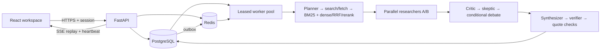

# MARS — durable multi-agent research

MARS now separates authenticated HTTP requests from background research execution.
PostgreSQL stores jobs, checkpoints, evidence, results, events and private memory;
Redis provides distributed limits, worker notifications, Streams and scoped caches.
Closing the browser does not cancel a job.

**Status:** locally tested hardening implementation, not a certified production
release. Docker, real PostgreSQL/Redis, live providers and production load have not
been verified on this host.
See [the verification record](docs/verification.md) for actual results and limits.
The historical PDF describes the old prototype and is not the runtime contract.

## Architecture



Search uses Tavily and real public HTML/text sources. Anthropic's official async
client runs the agent roles. Final claims link to exact fetched passages; model
entailment assessments are explicitly distinguished from independent factual truth.
No random, hash-based or confidence-derived benchmark scores are served.
Pinned local ONNX embeddings rank evidence and retrieve pgvector-backed memory.
Memory can be private to a session, private to a user, or explicitly shared with
an organization whose membership is checked on reads and final writes.

## Local startup (PowerShell)

Requires Python 3.12+, Node 22, PostgreSQL 16 with pgvector and Redis 7.4. Use a fresh environment;
the original bundled `backend/venv` is not portable.

```powershell
Copy-Item .env.example .env
# Edit .env: database password/DSN, Anthropic key, Tavily SEARCH_API_KEY, metrics token.
python -m venv .venv
.\.venv\Scripts\python.exe -m pip install -r backend/requirements-dev.txt
# If Docker is available, start the local dependencies:
docker compose up -d postgres redis
Set-Location backend
..\.venv\Scripts\python.exe -m app.providers.embeddings --download
..\.venv\Scripts\python.exe -m alembic upgrade head
..\.venv\Scripts\python.exe -m app.manage create-user --email you@example.com
..\.venv\Scripts\python.exe -m uvicorn app.main:app --host 127.0.0.1 --port 8000 --no-access-log --no-proxy-headers
```

In a second terminal, from the repository root:

```powershell
Set-Location backend
..\.venv\Scripts\python.exe -m app.workers.run
```

In a third terminal:

```powershell
Set-Location frontend
npm.cmd ci
npm.cmd run dev
```

Open `http://localhost:3000` and sign in. The API alone cannot execute jobs; the
worker must run. Missing credentials do not enable mock research.

## Docker startup

```powershell
Copy-Item .env.example .env
# Edit .env with real local configuration.
docker compose config --quiet
docker compose build
docker compose up -d
docker compose exec api python -m app.manage create-user --email you@example.com
```

Alembic runs as a one-shot dependency before API/workers. Production uses the
separate [deployment configuration](deploy/compose.production.yml), managed private
PostgreSQL/Redis, secret management and a same-origin TLS ingress.
Follow [exact deployment steps](docs/deployment.md); configure an actual target
before automating rollout. CI gates publishing on lint, typing, tests, real service
integration, browser tests, builds and dependency/container scans.

## Verification commands

```powershell
Set-Location backend
..\.venv\Scripts\python.exe -m ruff format --check app tests migrations
..\.venv\Scripts\python.exe -m ruff check app tests migrations
..\.venv\Scripts\python.exe -m mypy app
$env:RUN_EMBEDDING_TESTS='1'
..\.venv\Scripts\python.exe -m pytest -q -p no:cacheprovider
..\.venv\Scripts\python.exe -m pip_audit -r requirements.txt
Set-Location ../frontend
npm.cmd run lint
npm.cmd run typecheck
npm.cmd test
npm.cmd run build
# On Windows with Edge installed; CI installs Chromium instead:
$env:PLAYWRIGHT_CHANNEL='msedge'
npm.cmd exec playwright -- test
npm.cmd audit --audit-level=high
```

Set `TEST_DATABASE_URL` to a **disposable** PostgreSQL+pgvector database and
`TEST_REDIS_URL` to disposable Redis to activate service integration tests. Tests
create/drop their tables. Never use production URLs. Without these variables,
SQLite/fakeredis tests run and PostgreSQL-specific cases skip explicitly.

## Key implementation files

| Area | Files |
|---|---|
| Application and auth | `backend/app/main.py`, `api/auth.py`, `api/research.py`, `api/memory.py` |
| Durable state | `backend/app/db/models.py`, `db/repository.py`, `db/session.py` |
| Migrations | `backend/migrations/versions/0001_durable_jobs.py`, `0002_vector_memory.py`, `0003_memory_scopes.py` |
| Worker and events | `backend/app/workers/run.py`, `workers/queue.py` |
| Research | `backend/app/orchestration/workflow.py`, `agents/prompts.py` |
| Providers and safety | `backend/app/providers/anthropic.py`, `providers/search.py`, `providers/embeddings.py` |
| Evidence and belief evolution | `backend/app/evaluation/grounding.py`, `evaluation/beliefs.py` |
| Observability | `backend/app/core/telemetry.py`, `core/redis.py`, `db/session.py` |
| Browser lifecycle | `frontend/src/hooks/usePipeline.ts`, `src/sse.ts`, `src/api.ts` |
| Workspace | `frontend/src/App.tsx`, `src/components/MemoryPanel.tsx` |
| Configuration | `.env.example`, backend/frontend Dockerfiles, Compose and `.github/workflows/` |

Original retrieval, memory, evaluation and API modules moved under `backend/app/`
to repair imports. `backend/main.py` is a compatibility entrypoint. Legacy memory
SQL is historical; use Alembic for the actual v2 schema.

## Documentation

- [Architecture, schema and consistency guarantees](docs/architecture.md)
- [API endpoints, authentication and SSE contract](docs/api.md)
- [Local containers and production deployment](docs/deployment.md)
- [Security boundaries and limitations](docs/security.md)
- [Monitoring, cost controls, backups and failure recovery](docs/operations.md)
- [Troubleshooting](docs/troubleshooting.md)
- [Actual verification results and remaining gates](docs/verification.md)
- [Original engineering audit](docs/engineering-audit.md)

Environment variables and bounded defaults are in [.env.example](.env.example).
Do not put secrets in `VITE_*`, logs, commits, or screenshots. Independent accuracy
certification, production pgvector performance, and production load benchmarks
remain unverified. See the deployment guide for organization provisioning commands.
