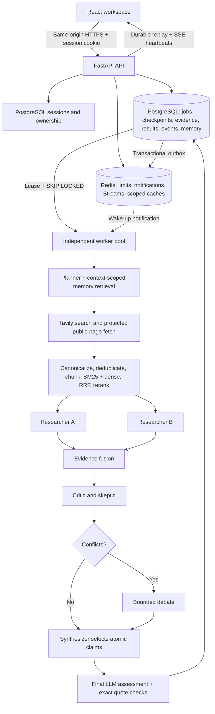

# Runtime architecture

## Durability and concurrency

The HTTP submit request commits a job and its first event, then sends a best-effort
Redis wake-up. Workers also reconcile PostgreSQL every two seconds, so losing a
notification cannot lose a job. Redis is never the sole copy of a result or event.

Workers atomically claim expired leases using `FOR UPDATE SKIP LOCKED`. Every
checkpoint, budget reservation, heartbeat and terminal write locks the job and
checks its current lease token and deadline. A recovered worker gets a new token;
late writes from the previous owner are rejected. Completed stages are reused.
Researchers run concurrently in an asyncio TaskGroup; a failed sibling cancels
the other. Provider calls occur outside database transactions.

Execution is **at least once**, not exactly once. If a provider answered immediately
before a crash and its stage was not committed, the call can repeat. Durable call
budgets bound that cost. Idempotent submission and fenced final writes prevent
duplicate jobs/results. Lease expiry bounds recovery time; cancellation is
checked approximately every second and before writes/new calls.

An SSE connection has no reference to the worker task. Disconnect closes only the
subscription. Sequence numbers and events are committed with each state change.
Redis Streams wake subscribers; PostgreSQL supplies ordered replay even if the
stream is trimmed or lost. The browser hydrates a snapshot before resubscribing,
deduplicates sequence numbers, cancels stale subscriptions, detects silent streams
after 30 seconds, and backs off on network errors. Refresh preserves an owner-scoped
job ID; ambiguous submissions preserve an idempotency key in sessionStorage.

## Evidence and metrics

Tavily supplies candidate URLs, never a prewritten final answer. The fetcher checks
HTTP(S), public DNS answers used by the connection, each redirect, MIME type, time,
and byte limits. It strips executable/navigation markup and bounds normalized text.
Canonical URLs and content hashes remove duplicates. BM25 ranks chunks for the
original and decomposed queries. Local MiniLM embeddings rank up to 64 shortlisted
passages; RRF fuses sparse and dense rankings; an LLM reranks the bounded shortlist.

Researchers return atomic claims with source IDs and exact passages. A separate
verifier assesses entailment and contradictions. Code rejects unknown sources and
quotes absent from fetched text. The final answer contains supported assessed
claims only; unsupported claims remain visible with their assessments. This is
not independent proof of truth: exact quotation checks prove provenance, while
entailment judgments can still be wrong. No numeric factual-confidence or benchmark
comparison is fabricated.

Coverage ratios use all proposed factual claims as the denominator; empty sets
return null. Publisher diversity counts registrable domains, not URLs/subdomains;
content diversity counts hashes. Syndicated text with formatting changes and
shared corporate ownership remain limitations. Source authority, independently
measured accuracy and calibrated confidence are unknown, not invented scores.

## Memory and preserved libraries

The primary runtime uses durable job checkpoints as working memory and
`memory_entries` as expiring, evidence-linked memory. Supported final claims are
embedded with a pinned local ONNX MiniLM model, normalized to 384 dimensions, and
stored with their model revision. Retrieval applies visibility, expiry and model
filters before pgvector cosine ordering and fuses those results with BM25. SQLite
uses an exact vector scan only for tests. No unbenchmarked ANN index is installed;
measure filtered cosine-query cost before scaling the memory corpus.

Session memory is restricted to its owner and session. User memory is private to
its owner across sessions. Organization memory requires explicit selection and
current membership; organization research reads only that organization's memory,
excluding the member's private context. Membership is checked again under lock
before final shared writes. Members can read shared findings; only the author can
delete them. Jobs/results remain owner-private. Sharing a finding includes its
supporting evidence. Removing membership blocks subsequent shared-memory reads.
Previously delivered information cannot be recalled from a browser or model call.

Prior memories are hypotheses for fresh retrieval, never substitutes for current
evidence. Operator deletion cascades durable user data, including that author's
shared findings. Local model assets must be provisioned before worker startup;
inference is offline and never downloads a model on a research request. Model
revision is pinned in configuration; embedding caches are owner-scoped for 24 hours.

Original BM25/RRF and belief-graph code is used by the primary workflow. Durable
evidence-fusion, conflict-graph and final-belief stages expose graph evolution
without inventing numeric confidence. Legacy episodic/semantic adapters remain
available with owner checks, but their separate historical SQL schema is not used
by the v2 pipeline. Do not apply the old SQL file alongside Alembic.

## Database

Three frozen reversible Alembic migrations define the schema:

| Revision | Schema change |
|---|---|
| 0001_durable_jobs | users, auth_sessions, research_jobs, agent_runs, research_events, sources, claims, claim_sources, research_results, memory_entries, audit_records |
| 0002_vector_memory | pgvector extension, memory embedding vector(384), embedding_model revision |
| 0003_memory_scopes | organizations, organization_memberships, job memory_scope/organization_id, memory organization_id |

The extension requires database privileges during migration and is retained on
downgrade because other applications may use it. Organization deletion cascades
shared memory and clears job organization references; such jobs cannot publish
new organization memory. User deletion cascades authored data and memberships.
Unique owner/idempotency keys serialize duplicate submissions; unique job/stage
checkpoints and job/event sequences prevent duplicates. Foreign keys cascade job
and user deletion. Dispatch and owner/expiry indexes cover primary access paths.
No process-local state is required to recover jobs. SQLite serializes transactions
for unit tests only; PostgreSQL locking must be tested separately.
